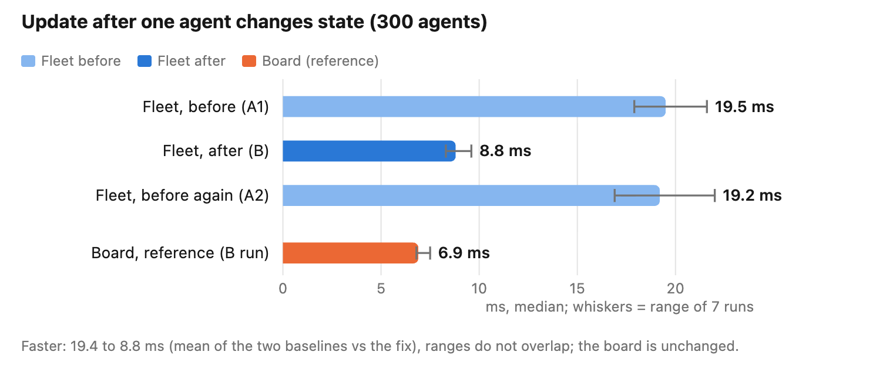
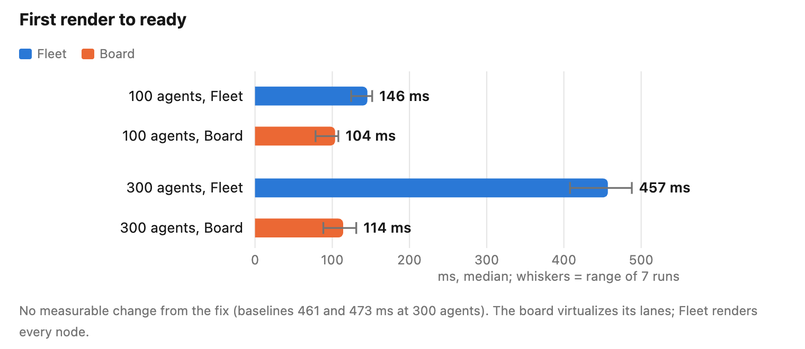

# Fleet view performance (stablyai/orca issue #44075)

Branch `feat/orchestration-fleet-view`. Baseline `3a063c0259` (Fleet without the node memo). Fix `36e0a83861` (re-render only changed nodes).

The runs were made before the branch's commit author email was rewritten, so the raw logs name the same two builds as `04d4fb053e` and `cd69d57fca`. Each rewritten commit has the same tree as its original.

## Verdict

- **Update after one agent changes state, 300 agents: faster.** Median 19.4 ms → 8.8 ms (−55%). The fix's range does not overlap either baseline's range, and the board, measured as a reference, did not change.
- **First render: no measurable change.** About 460 ms at 300 agents against about 115 ms for the board. The board virtualizes its lanes and Fleet renders every node. Fleet only mounts when the person picks it.




## Setup

- Machine: Ubuntu 22.04 server, 8 cores, idle apart from the harness (load average 0.9 to 2.4 during runs, from the harness itself).
- Surface: the production build of the component fixtures (`vite build --config config/vite.fixtures.config.ts`, React production), served by `vite preview`, driven by playwright-core's chromium-headless-shell. This is not the Electron renderer.
- Data: seeded snapshot generator (`fleet/fleet-scale-snapshot-fixtures.ts`): 100 or 300 cards over several projects and hosts, teams of 3 to 12 with three levels, subagents, independent agents, all buckets.
- Update path: every 250 ms the fixture flips one card between waiting and working, rebuilds the whole snapshot with fresh card objects (as the real snapshot builder and the pop-out IPC clone do) and commits it with `flushSync`. `flushMs` is render + commit + layout effects. Forced layout after the commit is timed separately.
- Order: production build A1 (baseline) → B (fix) → A2 (baseline again). Inside each build the harness alternates Fleet and Board, 7 runs per side, 40 update ticks per run, after one warm-up render per fixture.

## Results (production build, median of 7 runs [range], ms)

| Metric | A1 baseline | B fix | A2 baseline |
|---|---|---|---|
| Fleet update, 300 agents | 19.5 [17.9–21.6] | **8.8 [8.3–9.6]** | 19.2 [16.9–22.0] |
| Fleet update p95 (pooled ticks) | 47 | 36 | 46 |
| Board update, 300 agents | 7.4 [7.2–7.7] | 6.9 [6.8–7.5] | 7.1 [6.7–8.0] |
| Fleet first render, 300 agents | 461 [425–516] | 457 [408–488] | 473 [445–565] |
| Board first render, 300 agents | 107 [99–135] | 114 [89–131] | 125 [98–140] |
| Fleet first render, 100 agents | 139 [133–163] | 146 [125–152] | 150 [143–178] |
| Board first render, 100 agents | 86 [73–127] | 104 [78–108] | 97 [82–123] |

DOM elements after mount: Fleet 1,502 (100) and 5,951 (300); Board 923 and 1,223. During updates: 7,619 and 1,259.

Raw data: `results/aba-*.json`, `aba-summary.txt`, `aba-run.log`.

## What limited it

A CPU profile of an unminified production build (30 update ticks, 772 ms in ticks; the profiler inflates times, so these shares only locate the limiter):

| Where the time went | Share |
|---|---|
| React reconcile and commit, everything else | 45% |
| Forced layout the harness triggers after each commit (timed separately, not part of `flushMs`) | 26% |
| `dashboardCardAgeLabel` → i18next `translate`, once per node per update | 23% |
| `FleetNetworkNode` body without translation | 6% |

Every update re-rendered all ~210 Fleet nodes, and each one translated its "41m / 1h" label. A first attempt memoized nodes with the board's comparator, which itself translates both labels to compare them; production numbers did not move (18.9 [16.8–19.7] ms against baselines 19.1 and 18.1, `first-run-summary.txt`). The fix compares the age bucket (unit and count) numerically and caches labels per language, so an update re-renders only the node whose card or age bucket changed.

The board's card comparator still translates both labels per card per update; the same change would speed it up. That is existing code and is left for a separate PR.

## Checklist

1. **Limiter.** Before the fix: per-node translation plus re-rendering every node (profiled). After the fix, the remaining 8.8 ms was not profiled again (inferred: model rebuild and section re-render). First render: inferred from element counts (non-virtualized), not profiled separately.
2. **Tuning.** Both sides production React, same machine, data, harness, warm-up. Difference from the shipped app: headless Chromium, not Electron.
3. **Limits.** 10.6 ms saved, consistent with skipping 209 of 210 node subtrees (inferred from the profile above).
4. **Errors.** 0 errors and 0 problems in every run. One `/favicon.ico` 404 on page load is listed separately.
5. **Reproducibility.** 7 alternating runs per side; A1 and A2 agree; the fix sits outside both baseline ranges; the board reference is flat across A1, B and A2.
6. **Relevance.** At 300 agents an update moves from over one 60 Hz frame (16.7 ms) to under one at the median; p95 is still 36 ms (its cause was not investigated). First render remains the largest cost.
7. **Did the work happen.** Every run rendered exactly the generator's expected 210 Fleet nodes; the last flipped card shows its new state in the DOM; element counts are stable during updates.

## Rerun

`HARNESS.txt` has the full instructions. Short version, from an Orca checkout at this branch with a chromium-headless-shell available:

```bash
pnpm exec vite build --config config/vite.fixtures.config.ts
pnpm exec vite preview --config config/vite.fixtures.config.ts --host 127.0.0.1 --port 4791 --strictPort &
node run.mjs --repo <orca-checkout> --url http://127.0.0.1:4791 --out <out>/prod --runs 7 --ticks 40
python3 summarize.py <out>/prod/results.json
```

`server-aba.sh <base-sha> <fix-sha>` runs the A/B/A sequence used here.
